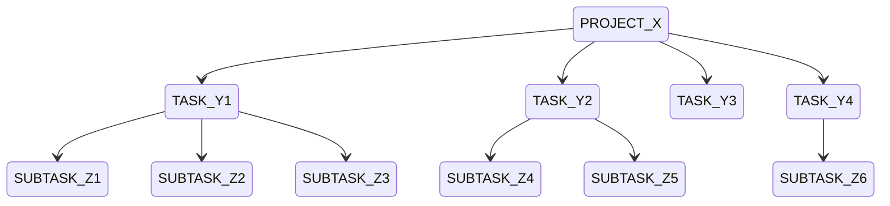
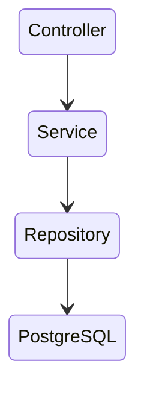

# Project Management Platform
A REST API for managing projects, by making use of tasks and priority-based subtasks, and showing statistics for every project. 

Built with Java 17, Spring Boot, PostgreSQL and Docker.

## Features
- CRUD for project management systems, with statistics for every project
- Import/Export full project implementation using JSON file format
- Analytics: completion rate, due date percent rate
- Project-Task and Task-Subtask relationship

## Quick start
Requirements: Java 17, Docker.

```bash
docker compose up -d        # starts PostgreSQL
./gradlew bootRun           # starts the API on http://localhost:8080
```

## Project Overview


Example project architecture*

## API ENDPOINTS

| Method | Endpoint | Description |
|--------|----------|-------------|
| GET | `/subtasks` | Lists all subtasks in all projects|
| GET | `/subtasks/{id}` | Returns a subtask using its `id`|
| GET | `/subtasks/{taskId}/list` | List all subtasks in a task using `taskId`|
| POST| `/subtasks` | Creates a subtask|
| PUT | `/subtasks/{id}/update-task` | Updates a subtask's task|
| PUT | `/subtasks/{id}/update-title` | Updates a subtask's `title` attribute|
| PUT | `/subtasks/{id}/update-description` | Updates a subtask's `description` attribute|
| PUT | `/subtasks/{id}/update-priority` | Updates a subtask's `priority` attribute|
| PUT | `/subtasks/{id}/update-duedate` | Updates a subtask's `dueDate` attribute|
| PUT | `/subtasks/{id}/completed` | Sets a subtask as completed|
| DELETE | `/subtasks/{id}` | Deletes a subtask|
| GET | `/tasks` | Lists all tasks in all projects|
| GET | `/tasks/{id}` | Returns a task using its `id`|
| GET | `/tasks/{projectId}/list` | List all tasks in a project using `projectId`|
| POST| `/tasks`| Creates a task|
| PUT | `/tasks/{id}/update-title` | Updates a task's `title` attribute|
| DELETE | `/tasks/{id}` | Deletes a task by `id`|
| GET | `/projects` | Lists all projects in all projects|
| GET | `/projects/{id}` | Returns a project using its `id`|
| POST| `/projects`| Creates a project|
| PUT | `/projects/{id}/update-title` | Updates a project's `title` attribute|
| PUT | `/projects/{id}/update-description` | Updates a project's `description` attribute|
| DELETE | `/projects/{id}` | Deletes a project by `id`|
| GET | `/projects/{id}/analytics/completion-rate` | Returns a percent rate(%) of the completed subtasks in a project by `id`|
| GET | `/projects/{id}/analytics/overdue-rate` | Returns a percent rate(%) of the overdue subtasks in a project by `id`|
| GET | `/projects/{id}/analytics/overview` | Returns an overview of a project by `id` with all tasks and corresponding subtasks|
| GET | `/projects/{id}/export` | Exports a project by `id` overview in a JSON file|
| GET | `/projects/import` | Imports a project overview from a JSON file|

## Architecture


- Controllers handle HTTP only and return DTO records, never entities
- Services hold the business rules and run inside transactions

## Limitations and next steps
- Single user, no authentication
- No frontend
- Planned: reminder for highest priority subtasks, multiple users, multithreading 